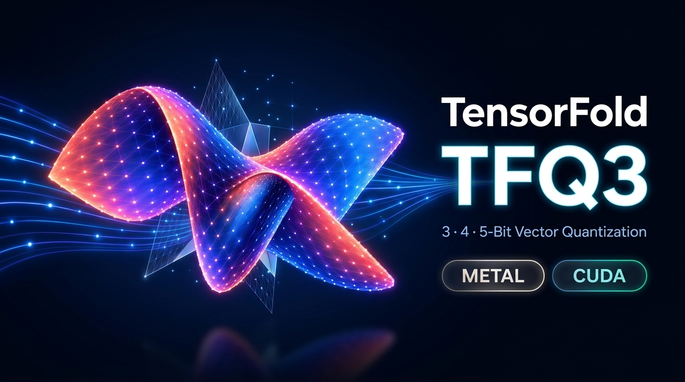

<p align="center">
  
</p>

# TFQ — TensorFold Native Quantization (`TFQ3`)

**Cross-Platform: Apple Silicon (Metal) & NVIDIA GPUs (CUDA `sm_80+`)**

**TFQ3** (*TensorFold Quantization v3 — supports **3-, 4-, and 5-bit**, including mixed-bit per layer or per expert; the `3` is the format version, not 3-bit only*) is an open, **100% data-free (zero-calibration)** weight quantization format, **Apple Silicon Metal & NVIDIA CUDA** GPU converter suite, and standalone inference kernel library built for [TensorFold](https://github.com/ashhart/TensorFold).

> **One Checkpoint, Both Platforms (Zero Re-Conversion):**
> A TFQ3 checkpoint quantized on a Mac runs **byte-for-byte unmodified** on an NVIDIA CUDA GPU — and a checkpoint quantized on an NVIDIA GPU runs **byte-for-byte unmodified** on Apple Silicon Metal. Same `pw_v3_tables.bin`, same `.tffpw` shards, same residual `.safetensors`, and the same `DFlash2` / `DSpine` / `MTP` speculative drafters.

Instead of uniform affine quantization or calibration-dependent Hessian fitting (GPTQ/AWQ/imatrix), TFQ3 combines:
1. A deterministic **randomized 2D Fast Walsh–Hadamard Transform (`2D FWHT-128`)** on every `128×128` weight tile to analytically eliminate channel outliers.
2. A single fixed **16 KiB universal Gaussian `2D-AffineCoset/half4` vector codebook** (`pw_v3_tables.bin`) with state-dependent coset hashing and zero-cost `split-K` resume.
3. **16 KiB–aligned zero-copy `.tffpw` shards** — identical on disk for **Apple Silicon Metal** (`bufferNoCopy` + SIMD/NAX) and **NVIDIA CUDA** (direct PTX `m16n8k16` split-K=8 Tensor Core decode/verify + fused routed MoE), giving sub-second loads (`0.2s–0.5s` for 27B on Metal) and **100% bit-exact speculative decoding** across `DFlash2`, `DSpine`, and `MTP` on both backends.

---

## Get Started

### 1. Install `tfq3` (one command — auto-detects Mac Metal or NVIDIA CUDA)

```bash
curl -fsSL https://raw.githubusercontent.com/ashhart/TFQ/main/install.sh | bash
```

*(Prefer building from a local clone? Run `git clone https://github.com/ashhart/TFQ.git && cd TFQ && make install`.)*

### 2. Convert any supported model

Pass a **Hugging Face repo ID** (auto-resolves your local HF cache or pulls it) or a **local directory**. `tfq3` auto-detects the model family (`Qwen3.8-27B`, `Qwen3.8-Flash-Next`, `GLM-5.3-Flash`), BF16 vs. 8-bit residual precision, and Metal vs. CUDA GPU backend, then packages and validates the finished checkpoint:

```bash
# Convert a model (defaults to 4-bit TFQ3 into ./<ModelName>-TFQ3)
tfq3 Qwen/Qwen3.8-27B

# Or directly from TensorFold (auto-pulls if needed, then converts):
tensorfold tfq3 Qwen/Qwen3.8-27B

# Pick a custom output directory or compact 3.5-bit / 3-bit profile
tfq3 /path/to/Qwen3.8-27B --profile 3.5b --out ./Qwen3.8-27B-TFQ3-3p5b

# Inspect & validate any TFQ3 checkpoint (or check your GPU toolchain)
tfq3 inspect -v ./Qwen3.8-27B-TFQ3
tfq3 doctor
```

### 3. Serve on Mac (Metal) or NVIDIA GPU (CUDA)

The exact same output folder runs unmodified on both platforms:

```bash
tensorfold serve ./Qwen3.8-27B-TFQ3 --host 0.0.0.0 --port 18650 --context 32768

# With bit-exact speculative decoding (DFlash2 on Metal or CUDA; DSpine on CUDA)
tensorfold serve ./Qwen3.8-27B-TFQ3 --drafter /path/to/Qwen3.8-27B-DFlash2 --host 0.0.0.0 --port 18650
```

---

## Why TFQ3?

On **Qwen3.8-27B** (exact `fp64` full-vocab KL divergence across all 248,320 logits vs. 8-bit gold, zero calibration data):

| Quantization | Disk Size | Unseen PPL (3,071 tok) | Mean KL vs 8-bit | p99 KL vs 8-bit | Same Top-1 | Metal Load |
|---|---:|---:|---:|---:|---:|---:|
| MLX 8-bit (Gold) | 27.50 GiB | 6.4485 | — | — | — | 3.27 s |
| MLX 4-bit (g64 affine) | 14.98 GiB | 6.6021 | `0.03352` | `0.27518` | 91.19% | 3.72 s |
| **TFQ3-4b (Pure BF16 base)** | **14.37 GiB** | **6.5829** | **`0.02316` (−31%)** | **`0.15037` (−45%)** | **91.68%** | **0.53 s** |
| **TFQ3-4b (8-bit residual base)** | **13.23 GiB** | **6.5855** | **`0.02308` (−31%)** | **`0.14865` (−46%)** | **91.29%** | **0.20 s** |
| TFQ3-3.5b (8-bit residual base) | 11.59 GiB | 6.6478 | `0.03779` | `0.25983` | 91.39% | 0.19 s |

### Supported Model Families, Backends & Speculative Drafters

Every checkpoint below runs unmodified on both **Metal (Apple Silicon)** and **CUDA (NVIDIA `sm_80+`)** in TensorFold:

| Model | Source | **TFQ3 Size** | Quality vs Gold | Metal Runtime & Drafters | CUDA Runtime & Drafters |
|---|---|---:|---|---|---|
| **Qwen3.8-27B** (Dense 64L) | HF BF16 or MLX 8-bit | **14.37 GiB** (BF16 base) / **13.23 GiB** (Q8 base) | **−31% mean KL / −46% p99 KL** vs MLX 4-bit | [`#4974`](https://github.com/ashhart/TensorFold/pull/4974) · `DFlash2` (`44.2 → 77.4 tok/s`, **+75%**, bit-exact) | [`#4986`](https://github.com/ashhart/TensorFold/pull/4986) · `DFlash2` (`15.1 → 52.5 tok/s`, **3.48×**) & `DSpine` (`56.6 tok/s`, **3.75×**, bit-exact) |
| **Qwen3.8-Flash-Next** (512E MoE) | MLX 8-bit (189 GiB) | **78.99 GiB** (fits 128 GB Macs & GB10/H200) | **5.996 PPL** vs 6.007 gold (MLX 4-bit: 6.644) | [`#4964`](https://github.com/ashhart/TensorFold/pull/4964) · `MTP d3` (`82.9 → 154.5 tok/s`, **+86%**, bit-exact) | [`#4986`](https://github.com/ashhart/TensorFold/pull/4986) · `MTP` (`mtp_00.tffpw`) + 3b/4b/8b PLE |
| **GLM-5.3-Flash** (288E MoE) | FP8 / MLX 8-bit (320 GB) | **139.6 GB** (130 GiB) | **22.61 PPL** vs 24.16 FP8 (MLX 4-bit: 25.32) | [`#4953`](https://github.com/ashhart/TensorFold/pull/4953) · `MTP` (`95.2 tok/s`, **+38%**) & `DFlash2` (`85.3 tok/s`, **+23%**) | [`#4986`](https://github.com/ashhart/TensorFold/pull/4986) · `MTP` + `DFlash2` (shared TFQ3 `DraftHead`, zero extra VRAM) |

*See [`docs/BENCHMARKS.md`](docs/BENCHMARKS.md) for complete KL, PPL, SNR, Metal + CUDA throughput, and speculative decoding tables.*

---

## Requirements & Build

- **Apple Silicon (macOS, M1–M5 — Metal):** Xcode Command Line Tools (`clang++`, `xcrun metal`, `xcrun metallib`).
- **NVIDIA GPUs (Linux, Ampere / Ada / Hopper / Blackwell — CUDA `sm_80+`):** CUDA Toolkit (`nvcc` 12+/13+) and `g++`.
- **Zero external C++ dependencies** — `make` auto-detects macOS Metal vs. Linux CUDA.

```bash
git clone https://github.com/ashhart/TFQ.git
cd TFQ

# macOS (Apple Silicon Metal):
make install  # builds Metal GPU converters + metallibs and installs `tfq3` into ~/.local/bin
make test     # runs Python mathematical reference self-test

# Linux (NVIDIA CUDA — pass CUDA_ARCH=sm_80 / sm_86 / sm_89 / sm_90 / sm_100 / sm_121):
make install CUDA_ARCH=sm_121
make test-cuda CUDA_ARCH=sm_121   # fp64 GPU parity (dense PTX m16n8k16 + mixed-bit MoE + bit-exact r1==r16==r32) + bench
```

Built artifacts in `build/`:
- `tfq3-qwen27-convert` (Metal) / `tfq3-qwen27-convert-cuda` (CUDA) & `tfq3-qwen27-package` — Dense `Qwen3.8-27B` converter (BF16 & MLX 8-bit/64)
- `tfq3-flashnext-convert` (Metal) / `tfq3-flashnext-convert-cuda` (CUDA) — `Qwen3.8-Flash-Next` 512-expert MoE + PLE converter
- `tfq3-glm-convert` (Metal) / `tfq3-glm-convert-cuda` (CUDA) — `GLM-5.3-Flash` 288-expert MoE + Non-MoE converter
- `tfq3-cuda-test` — Standalone CUDA `fp64` parity test (dense + mixed-bit MoE + bit-exact speculative verify) & throughput benchmark
- `tfq3-inspect` — Cross-platform validator and inspector for `pw_v3_tables.bin`, `TFPN`, and `TFPW` shards

Reusable header-only CUDA inference kernels live in [`src/kernels/cuda/tfq3_cuda.cuh`](src/kernels/cuda/tfq3_cuda.cuh) (2D FWHT-128, bank-conflict-free direct PTX `m16n8k16` split-K=8 & fused dense kernels bit-exact across `rows = 1..64`, fused mixed-bit 3b/4b/5b routed MoE kernels, and BF16 residual GEMV/GEMM — zero `<mma.h>` dependency, verified to `265 GB/s` at `rows=1` and `225–248 GB/s` at `rows=16` on NVIDIA GB10).

---

## Per-Family Commands & Advanced Options

### 1. Qwen3.8-27B (from Official Hugging Face BF16 or MLX 8-bit)

The script auto-selects Metal on macOS and CUDA on Linux, converts, packages residuals/config/tokenizer, and validates the standalone checkpoint (~3 minutes on Apple M5 Ultra; ~5.5 s/layer on NVIDIA GB10):

```bash
# Option A: Pure BF16 source (e.g. Qwen/Qwen3.8-27B) -> 14.37 GiB TFQ3-4b (zero MLX quantization anywhere)
./scripts/quantize_qwen27.sh /path/to/Qwen3.8-27B /path/to/Qwen3.8-27B-TFQ3 4b bf16

# Option B: MLX 8-bit/64 source -> 13.23 GiB TFQ3-4b (-1.75 GiB smaller than MLX 4-bit)
./scripts/quantize_qwen27.sh /path/to/Qwen3.8-27B-MLX-8bit /path/to/Qwen3.8-27B-TFQ3-Q8 4b q8

# Option C: Ultra-compact 3.5b hybrid (~11.59 GiB Q8 base / ~12.72 GiB BF16 base) or pure 3b (~10.38 GiB)
./scripts/quantize_qwen27.sh /path/to/Qwen3.8-27B /path/to/Qwen3.8-27B-TFQ3-3p5b 3.5b bf16
```

**What `tfq3-qwen27-convert` (`-cuda`) + `tfq3-qwen27-package` handle automatically:**
- Auto-detects HF BF16 (`model.language_model.*` + bare `lm_head.weight`), MLX (`language_model.model.*`), or plain (`model.*`) namespaces.
- Auto-detects HF 0-centered norms (`mean < 0.5`) and applies `+1.0` fold into the TensorFold/MLX 1-centered convention (leaving `linear_attn.norm.weight` untouched).
- Converts `F32` scalar norms to `BF16` and reshapes HF `conv1d.weight` from `[10240, 1, 4]` to `[10240, 4, 1]`.
- Emits 4 cross-platform shards (`<= 3.43 GiB` each for 16 GB Mac `maxBufferLength` safety) with contiguous `gate+up` and `k+v` tensors for fused Metal & CUDA dispatch.
- Strips `"quantization"` from `config.json` automatically when `--residual bf16` is selected.

Serve the exact same output folder in TensorFold on **either Apple Silicon (Metal) or NVIDIA GPU (CUDA)**, with or without speculative drafters:

```bash
# Inspect checkpoint & memory budget
tensorfold-native info /path/to/Qwen3.8-27B-TFQ3

# Plain serving (Metal or CUDA)
tensorfold-native serve /path/to/Qwen3.8-27B-TFQ3 --host 0.0.0.0 --port 18650 --context 32768

# With bit-exact speculative decoding (DFlash2 on Metal or CUDA; DSpine on CUDA)
tensorfold-native serve /path/to/Qwen3.8-27B-TFQ3 --drafter /path/to/Qwen3.8-27B-DFlash2 --host 0.0.0.0 --port 18650 --context 32768
tensorfold-native serve /path/to/Qwen3.8-27B-TFQ3 --drafter /path/to/Qwen3.8-27B-DSpine  --host 0.0.0.0 --port 18650 --context 32768
```

### 2. Qwen3.8-Flash-Next (512-Expert MoE + MTP -> ~79 GiB)

Use `./build/tfq3-flashnext-convert` on macOS (Metal) or `./build/tfq3-flashnext-convert-cuda` on Linux (CUDA):

```bash
CONV=./build/tfq3-flashnext-convert        # or ./build/tfq3-flashnext-convert-cuda on Linux/CUDA

# Boundary layers (L0-L5, L47) with 5b/4b/3b, deep layers (L6-L46 + MTP) with 4b/3b
$CONV --model /path/to/FlashNext-8bit --out /path/to/FlashNext-TFQ3 --mode moe --layers 0 5 --n5 64 --n4 192
$CONV --model /path/to/FlashNext-8bit --out /path/to/FlashNext-TFQ3 --mode moe --layers 6 46 --n5 0 --n4 192
$CONV --model /path/to/FlashNext-8bit --out /path/to/FlashNext-TFQ3 --mode moe --layers 47 47 --n5 64 --n4 192 --mtp

# Requantize PLE embeddings to 3-bit/32 (23.84 GiB) and package standalone checkpoint
$CONV --model /path/to/FlashNext-8bit --out /path/to/FlashNext-TFQ3 --mode requant-ple --ple-bits 3
python3 src/converters/flashnext/package.py --src /path/to/FlashNext-8bit --out /path/to/FlashNext-TFQ3 --extract-nonmoe --write-index --ple-bits 3 --move-ple

# Validate all 49 shards + codebook (runs on both Metal and CUDA with built-in MTP drafter)
./build/tfq3-inspect /path/to/FlashNext-TFQ3
```

*(Pass `--trace <routing_counts.txt>` to enable optional HeatAlloc routing-frequency bit allocation across experts; omit `--trace` for pure index-order or uniform bit allocation.)*

### 3. GLM-5.3-Flash (288-Expert MoE + MTP / DFlash2 -> 130 GiB)

Use `./build/tfq3-glm-convert` on macOS (Metal) or `./build/tfq3-glm-convert-cuda` on Linux (CUDA):

```bash
CONV=./build/tfq3-glm-convert              # or ./build/tfq3-glm-convert-cuda on Linux/CUDA

# MoE layers (42 routed layers) + unified non-MoE shard
$CONV --model /path/to/GLM-5.3-Flash-FP8 --out /path/to/GLM-TFQ3 --mode heat543 --layers 3 6 [--trace routing.txt]
$CONV --model /path/to/GLM-5.3-Flash-FP8 --out /path/to/GLM-TFQ3 --mode heat43  --layers 7 44 [--trace routing.txt]
$CONV --model /path/to/GLM-5.3-Flash-FP8 --out /path/to/GLM-TFQ3 --mode nonmoe --fast4b
./build/tfq3-inspect /path/to/GLM-TFQ3

# Serve on Metal or CUDA with built-in MTP or external DFlash2 drafter:
tensorfold-native serve /path/to/GLM-TFQ3 --drafter /path/to/GLM-5.3-Flash-DFlash2
```

### 4. Inspect & Validate Any TFQ3 Checkpoint or Reference-Decode a Tile

```bash
# Validate alignment, bounds, bit widths, bpw, and per-tensor SNR
./build/tfq3-inspect -v /path/to/Qwen3.8-27B-TFQ3

# Pure Python + NumPy mathematical reference (exact bit-for-bit decode of any TFPN tensor tile)
python3 reference/tfq3_reference.py --self-test
python3 reference/tfq3_reference.py --shard /path/to/qwen27_tfq3-00001-of-00004.tffpw --tensor model.layers.0.mlp.down_proj
```

---

## Documentation

- **[`docs/HOW_IT_WORKS.md`](docs/HOW_IT_WORKS.md)** — Mathematical formulation of `2D FWHT-128`, `2D-AffineCoset/half4` vector quantization, zero-calibration design, state-hash split-K resume, and both Apple Silicon Metal and NVIDIA CUDA Tensor Core execution.
- **[`docs/FORMAT_SPEC.md`](docs/FORMAT_SPEC.md)** — Byte-level cross-platform binary specification for `pw_v3_tables.bin` (`PWV3`), dense/non-MoE shards (`TFPN`), and MoE layer shards (`TFPW`) for implementing loaders in any Metal or CUDA inference engine.
- **[`docs/BENCHMARKS.md`](docs/BENCHMARKS.md)** — Full KL divergence, perplexity, SNR, Metal + CUDA throughput, speculative decoding (`DFlash2` / `DSpine` / `MTP`), and memory footprint measurements across `Qwen3.8-27B`, `Qwen3.8-Flash-Next`, and `GLM-5.3-Flash`.
- **[`reference/tfq3_reference.py`](reference/tfq3_reference.py)** — Clean, standalone NumPy reference implementation matching both Metal and CUDA kernels.

---

## FAQ

- **Does `TFQ3` mean 3-bit only?** **No.** The `3` is **format version 3** (like `EXL3`). TFQ3 supports **3-bit, 4-bit, and 5-bit** — including mixed bit widths per layer or per expert in the same checkpoint (e.g., `TFQ3-4b` for `Qwen3.8-27B`, and mixed 3/4/5-bit `HeatAlloc` for `Qwen3.8-Flash-Next` and `GLM-5.3-Flash`).
- **Does the exact same checkpoint work on both Mac (Metal) and NVIDIA (CUDA)?** **Yes.** TFQ3 uses one canonical little-endian binary format (`pw_v3_tables.bin` + `.tffpw` + `.safetensors`). You can quantize once on either platform and copy the directory directly to the other with zero conversion or repacking.
- **Is calibration data used to quantize weights?** **No.** Every dense and MoE weight matrix is quantized 100% data-free (no WikiText/C4/RedPajama pass, no Hessians, no imatrix). The 2D FWHT-128 rotation Gaussianizes arbitrary weight matrices analytically, and the 16 KiB codebook (`pw_v3_tables.bin`) is generated once from a synthetic unit Gaussian prior.
- **What about `HeatAlloc` on MoE models?** Optional. For MoE models with hundreds of experts (288–512), you can optionally pass `--trace` containing per-layer expert routing counts so hot experts receive 4- or 5-bit budgets while cold experts use 3-bit. Even with `HeatAlloc`, the weights themselves are still quantized 100% data-free. Dense models (`Qwen3.8-27B`) use zero data anywhere.

---

## License

Apache License 2.0 — see [`LICENSE`](LICENSE).
